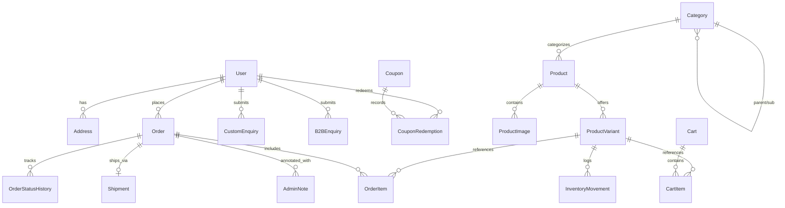

# ZARF WEAR — DATABASE SCHEMA SPECIFICATION
**Version:** 1.0.0  
**ORM:** Prisma ORM  
**Target Database:** PostgreSQL (Compatible with standard SQL engines)  
**Standard:** All monetary values stored as integer Indian Paise (`paise`).  

---

## 1. Schema Overview & Relational Architecture

The database is structured to support both retail B2C order workflows and bespoke B2B procurement, with audit trails for every order status transition and inventory movement.



---

## 2. Complete Prisma Schema Definition

```prisma
datasource db {
  provider = "postgresql"
  url      = env("DATABASE_URL")
}

generator client {
  provider = "prisma-client-js"
}

// -------------------------------------------------------------
// ENUMS
// -------------------------------------------------------------

enum UserRole {
  CUSTOMER
  ADMIN
  STAFF
}

enum ImageViewType {
  FRONT
  BACK
  DETAIL
  LIFESTYLE
}

enum OrderStatus {
  ORDER_REQUESTED
  UNDER_REVIEW
  QUOTATION_SENT
  AWAITING_APPROVAL
  CONFIRMED
  PROCESSING
  IN_PRODUCTION
  SHIPPED
  DELIVERED
  CANCELLED
}

enum InventoryMovementType {
  RESTOCK
  RESERVED
  FULFILLED
  DAMAGED_RETURN
  AUDIT_CORRECTION
}

enum EnquiryStatus {
  NEW
  IN_REVIEW
  QUOTED
  SAMPLE_APPROVED
  CONVERTED
  REJECTED
}

enum DiscountType {
  PERCENTAGE
  FIXED_PAISE
}

enum ShipmentStatus {
  PENDING
  LABEL_CREATED
  IN_TRANSIT
  OUT_FOR_DELIVERY
  DELIVERED
  FAILED_ATTEMPT
  RETURNED
}

// -------------------------------------------------------------
// USER & AUTHENTICATION
// -------------------------------------------------------------

model User {
  id               String             @id @default(cuid())
  email            String             @unique
  passwordHash     String?
  name             String?
  phone            String?
  role             UserRole           @default(CUSTOMER)
  createdAt        DateTime           @default(now())
  updatedAt        DateTime           @updatedAt

  addresses        Address[]
  orders           Order[]
  customEnquiries  CustomEnquiry[]
  b2bEnquiries     B2BEnquiry[]
  couponRedemptions CouponRedemption[]
  sessions         Session[]
  accounts         Account[]
  cart             Cart?

  @@index([email])
}

model Account {
  id                String   @id @default(cuid())
  userId            String
  type              String
  provider          String
  providerAccountId String
  refresh_token     String?  @db.Text
  access_token      String?  @db.Text
  expires_at        Int?
  token_type        String?
  scope             String?
  id_token          String?  @db.Text
  session_state     String?

  user              User     @relation(fields: [userId], references: [id], onDelete: Cascade)

  @@unique([provider, providerAccountId])
}

model Session {
  id           String   @id @default(cuid())
  sessionToken String   @unique
  userId       String
  expires      DateTime
  user         User     @relation(fields: [userId], references: [id], onDelete: Cascade)
}

model Address {
  id           String   @id @default(cuid())
  userId       String?
  fullName     String
  phone        String
  line1        String
  line2        String?
  landmark     String?
  city         String
  state        String
  postalCode   String   // 6-digit PIN in India
  country      String   @default("India")
  isDefault    Boolean  @default(false)
  createdAt    DateTime @default(now())
  updatedAt    DateTime @updatedAt

  user         User?    @relation(fields: [userId], references: [id], onDelete: SetNull)
  orders       Order[]

  @@index([userId])
  @@index([postalCode])
}

// -------------------------------------------------------------
// CATALOG & INVENTORY
// -------------------------------------------------------------

model Category {
  id          String     @id @default(cuid())
  slug        String     @unique
  name        String
  description String?    @db.Text
  imageUrl    String?
  parentId    String?
  sortOrder   Int        @default(0)
  isActive    Boolean    @default(true)
  createdAt   DateTime   @default(now())
  updatedAt   DateTime   @updatedAt

  parent      Category?  @relation("CategoryHierarchy", fields: [parentId], references: [id], onDelete: SetNull)
  children    Category[] @relation("CategoryHierarchy")
  products    Product[]

  @@index([slug])
  @@index([parentId])
}

model Product {
  id               String           @id @default(cuid())
  slug             String           @unique
  title            String
  subtitle         String?
  description      String           @db.Text
  fabricDetails    String?          @db.Text
  careInstructions String?          @db.Text
  basePriceInPaise Int              // Base price in Indian Paise (e.g. 149900 = ₹1,499)
  isFeatured       Boolean          @default(false)
  isActive         Boolean          @default(true)
  isB2BEligible    Boolean          @default(true)
  categoryId       String
  createdAt        DateTime         @default(now())
  updatedAt        DateTime         @updatedAt

  category         Category         @relation(fields: [categoryId], references: [id])
  images           ProductImage[]
  variants         ProductVariant[]

  @@index([slug])
  @@index([categoryId])
  @@index([isActive, isFeatured])
}

model ProductImage {
  id        String        @id @default(cuid())
  productId String
  url       String
  altText   String?
  sortOrder Int           @default(0)
  viewType  ImageViewType @default(FRONT)
  createdAt DateTime      @default(now())

  product   Product       @relation(fields: [productId], references: [id], onDelete: Cascade)

  @@index([productId])
}

model ProductVariant {
  id                    String              @id @default(cuid())
  productId             String
  sku                   String              @unique
  size                  String              // XS, S, M, L, XL, XXL, 3XL
  colorName             String              // Onyx Black, Bone White, etc.
  colorHex              String              // #111111, #F5F3EE
  priceAdjustmentInPaise Int                @default(0) // Added to product basePrice
  stockQuantity         Int                 @default(0)
  minOrderQuantity      Int                 @default(1)
  createdAt             DateTime            @default(now())
  updatedAt             DateTime            @updatedAt

  product               Product             @relation(fields: [productId], references: [id], onDelete: Cascade)
  inventoryMovements    InventoryMovement[]
  cartItems             CartItem[]
  orderItems            OrderItem[]

  @@unique([productId, size, colorName])
  @@index([sku])
}

model InventoryMovement {
  id          String                @id @default(cuid())
  variantId   String
  type        InventoryMovementType
  quantity    Int                   // Positive for additions, negative for deductions
  balance     Int                   // Resulting stock quantity
  note        String?
  referenceId String?               // e.g. Order ID
  createdAt   DateTime              @default(now())

  variant     ProductVariant        @relation(fields: [variantId], references: [id], onDelete: Cascade)

  @@index([variantId])
}

// -------------------------------------------------------------
// CART & COMMERCE
// -------------------------------------------------------------

model Cart {
  id        String     @id @default(cuid())
  userId    String?    @unique
  sessionId String?    @unique
  createdAt DateTime   @default(now())
  updatedAt DateTime   @updatedAt

  user      User?      @relation(fields: [userId], references: [id], onDelete: Cascade)
  items     CartItem[]
}

model CartItem {
  id        String         @id @default(cuid())
  cartId    String
  variantId String
  quantity  Int            @default(1)
  createdAt DateTime       @default(now())
  updatedAt DateTime       @updatedAt

  cart      Cart           @relation(fields: [cartId], references: [id], onDelete: Cascade)
  variant   ProductVariant @relation(fields: [variantId], references: [id])

  @@unique([cartId, variantId])
}

// -------------------------------------------------------------
// ORDERS & FULFILLMENT
// -------------------------------------------------------------

model Order {
  id                 String               @id @default(cuid())
  referenceNumber    String               @unique // Format: ZRF-YYYYMMDD-XXXX
  userId             String?
  customerName       String
  customerEmail      String
  customerPhone      String
  deliveryAddressId  String?
  status             OrderStatus          @default(ORDER_REQUESTED)
  subtotalInPaise    Int
  discountInPaise    Int                  @default(0)
  shippingFeeInPaise Int                  @default(0)
  taxInPaise         Int                  @default(0)
  totalAmountInPaise Int
  couponCode         String?
  notes              String?              @db.Text
  createdAt          DateTime             @default(now())
  updatedAt          DateTime             @updatedAt

  user               User?                @relation(fields: [userId], references: [id], onDelete: SetNull)
  deliveryAddress    Address?             @relation(fields: [deliveryAddressId], references: [id], onDelete: SetNull)
  items              OrderItem[]
  statusHistory      OrderStatusHistory[]
  shipment           Shipment?
  adminNotes         AdminNote[]

  @@index([referenceNumber])
  @@index([customerEmail])
  @@index([customerPhone])
  @@index([status])
  @@index([createdAt])
}

model OrderItem {
  id                 String         @id @default(cuid())
  orderId            String
  variantId          String
  productTitle       String         // Frozen snapshot of title
  size               String         // Frozen snapshot of size
  colorName          String         // Frozen snapshot of color
  unitPriceInPaise   Int            // Snapshot of unit price
  quantity           Int
  totalPriceInPaise  Int            // unitPriceInPaise * quantity

  order              Order          @relation(fields: [orderId], references: [id], onDelete: Cascade)
  variant            ProductVariant @relation(fields: [variantId], references: [id])

  @@index([orderId])
  @@index([variantId])
}

model OrderStatusHistory {
  id          String      @id @default(cuid())
  orderId     String
  fromStatus  OrderStatus?
  toStatus    OrderStatus
  comment     String?
  createdBy   String      @default("SYSTEM") // User ID or "SYSTEM"
  createdAt   DateTime    @default(now())

  order       Order       @relation(fields: [orderId], references: [id], onDelete: Cascade)

  @@index([orderId])
}

model Shipment {
  id                String         @id @default(cuid())
  orderId           String         @unique
  courierName       String         // e.g. Delhivery, Bluedart, DTDC
  trackingNumber    String         // AWB / Tracking reference
  trackingUrl       String?
  status            ShipmentStatus @default(PENDING)
  dispatchDate      DateTime?
  estimatedDelivery DateTime?
  actualDelivery    DateTime?
  createdAt         DateTime       @default(now())
  updatedAt         DateTime       @updatedAt

  order             Order          @relation(fields: [orderId], references: [id], onDelete: Cascade)

  @@index([trackingNumber])
}

// -------------------------------------------------------------
// BESPOKE CUSTOM & B2B ENQUIRIES
// -------------------------------------------------------------

model CustomEnquiry {
  id              String        @id @default(cuid())
  enquiryNumber   String        @unique // Format: ENQ-CUST-YYYYMMDD-XXXX
  userId          String?
  customerName    String
  customerPhone   String        // WhatsApp number
  customerEmail   String
  apparelCategory String        // e.g. "Oversized T-shirt", "Hoodie"
  estimatedQty    Int
  printMethod     String?       // "Screen Print", "DTG", "Puff", "Embroidery"
  sizeBreakdown   String?       // e.g. "S:10, M:20, L:20"
  colorPreferences String?
  notes           String?       @db.Text
  artworkUrls     String?       @db.Text // JSON string array of URLs
  whatsappText    String?       @db.Text
  quotedAmountInPaise Int?
  status          EnquiryStatus @default(NEW)
  createdAt       DateTime      @default(now())
  updatedAt       DateTime      @updatedAt

  user            User?         @relation(fields: [userId], references: [id], onDelete: SetNull)

  @@index([enquiryNumber])
  @@index([status])
}

model B2BEnquiry {
  id              String        @id @default(cuid())
  enquiryNumber   String        @unique // Format: ENQ-B2B-YYYYMMDD-XXXX
  userId          String?
  companyName     String
  contactPerson   String
  designation     String?
  gstin           String?
  email           String
  phone           String
  category        String        // e.g. "Corporate Uniforms", "Team Merch"
  quantity        Int
  budgetRange     String?
  deadlineDate    DateTime?
  deliveryCity    String
  deliveryPincode String
  requirements    String        @db.Text
  quotedAmountInPaise Int?
  status          EnquiryStatus @default(NEW)
  createdAt       DateTime      @default(now())
  updatedAt       DateTime      @updatedAt

  user            User?         @relation(fields: [userId], references: [id], onDelete: SetNull)

  @@index([enquiryNumber])
  @@index([companyName])
  @@index([status])
}

// -------------------------------------------------------------
// PROMOTIONS, AUDITING & SETTINGS
// -------------------------------------------------------------

model Coupon {
  id                  String             @id @default(cuid())
  code                String             @unique
  discountType        DiscountType
  discountValue       Int                // Percentage (e.g. 10 for 10%) or Paise (e.g. 20000 for ₹200)
  minOrderValueInPaise Int               @default(0)
  maxDiscountInPaise  Int?               // Cap for percentage discounts
  usageLimit          Int?
  usageCount          Int                @default(0)
  startDate           DateTime           @default(now())
  endDate             DateTime?
  isActive            Boolean            @default(true)
  createdAt           DateTime           @default(now())
  updatedAt           DateTime           @updatedAt

  redemptions         CouponRedemption[]

  @@index([code])
}

model CouponRedemption {
  id        String   @id @default(cuid())
  couponId  String
  userId    String?
  orderId   String?
  redeemedAt DateTime @default(now())

  coupon    Coupon   @relation(fields: [couponId], references: [id], onDelete: Cascade)
  user      User?    @relation(fields: [userId], references: [id], onDelete: SetNull)

  @@index([couponId])
}

model AdminNote {
  id         String   @id @default(cuid())
  orderId    String
  authorName String
  note       String   @db.Text
  isInternal Boolean  @default(true)
  createdAt  DateTime @default(now())

  order      Order    @relation(fields: [orderId], references: [id], onDelete: Cascade)

  @@index([orderId])
}

model StoreSettings {
  id                    String   @id @default("default")
  storeName             String   @default("ZARF Wear")
  whatsappNumber        String   @default("+919876543210")
  supportEmail          String   @default("support@zarfwear.in")
  supportPhone          String   @default("+918000000000")
  address               String   @default("ZARF Studios, Industrial Fashion District, Mumbai, MH, 400013")
  freeShippingThresholdInPaise Int @default(199900) // ₹1,999.00
  standardShippingFeeInPaise   Int @default(9900)   // ₹99.00
  b2bMinimumOrderQuantity      Int @default(25)
  orderPrefix           String   @default("ZRF")
  createdAt             DateTime @default(now())
  updatedAt             DateTime @updatedAt
}
```

