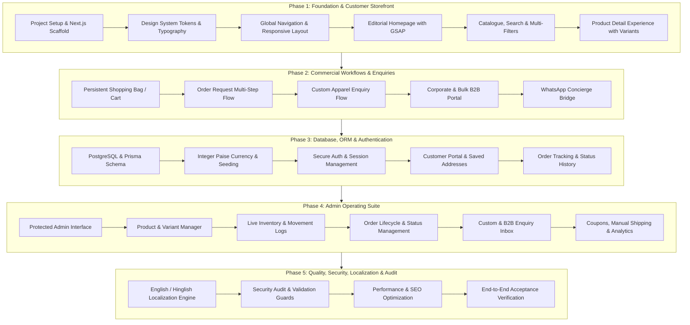

# ZARF WEAR — MASTER PROJECT PLAN
**Version:** 1.0.0  
**Target Market:** India (Pan-India B2C & B2B)  
**Status:** In Progress — Phase 1 Kickoff  
**Tech Stack:** Next.js (App Router), TypeScript, Tailwind CSS, GSAP, PostgreSQL, Prisma ORM, Zod, NextAuth / JWT  

---

## 1. Executive Summary & Objective

**ZARF Wear** is an all-in-one premium custom apparel and ready-to-wear brand operating in India. The platform bridges high-end streetwear editorial aesthetics with a robust, enterprise-grade B2B and B2C commercial engine. 

Unlike off-the-shelf Shopify templates, ZARF Wear delivers:
1. **Editorial Luxury Presentation:** Muted architectural palette (`#111111` Near Black, `#F5F3EE` Warm Off-White, `#777777` Neutral Grey, `#C8FF4D` Acid Lime Accent), high-typography, smooth GSAP micro-interactions, and expansive imagery.
2. **Order Request & Quotation Engine:** Tailored for the custom fashion market where V1 operates on a verified **Order Request System** (eliminating premature fake payment gateways, while laying the exact transactional groundwork for future payment integration).
3. **B2B Bulk & Corporate Procurement:** Dedicated workflow for corporate uniforms, college merchandise, sports teams, and brand merchandise with MOQ rules.
4. **Custom Apparel & WhatsApp Bridge:** Structured enquiry intake capturing silhouettes, prints, quantities, notes, and artwork references, paired with an automated WhatsApp concierge bridge.
5. **Secure Administrative & Fulfillment Hub:** Protected portal for inventory management by variant, order status lifecycle management, manual courier tracking, customer tracking, and real-time operational analytics.

---

## 2. Phased Development Roadmap

---

## 3. Scope Matrix by Phase

| Phase | Core Deliverables | Technical Artifacts | Success Benchmark |
|---|---|---|---|
| **Phase 1** | Project setup, design system tokens, layout, header/footer, homepage, catalog, search/filters, product details with color/size swatches, size guide, gallery view. | `tailwind.config.ts`, `globals.css`, `Header.tsx`, `Hero.tsx`, `ProductGrid.tsx`, `ProductDetail.tsx`, demo catalog. | Zero TypeScript errors, responsive across desktop (1440px), tablet (768px), and mobile (375px), smooth GSAP effects. |
| **Phase 2** | Cart drawer/page, order request checkout, guest + customer modes, custom apparel enquiry wizard, B2B bulk form, WhatsApp URL generator. | `CartStore.ts`, `OrderRequestForm.tsx`, `CustomEnquiryForm.tsx`, `B2BEnquiryForm.tsx`, `whatsapp.ts`. | Validated order requests generating reference IDs; WhatsApp links pre-populated with exact SKU & specs. |
| **Phase 3** | PostgreSQL schema via Prisma, atomic integer pricing (paise), password hashing, JWT/session auth, user profile, order history, tracking lookup. | `schema.prisma`, seed script, `auth.ts`, `/api/auth/*`, `/account/*`, `/track/*`. | Strict role segregation (`CUSTOMER` vs `ADMIN`), transactional order placement, zero float math. |
| **Phase 4** | Protected `/admin` suite: KPI dashboard, product CRUD, inventory adjustment, order status transitions with notes, enquiry management, manual shipping dispatch. | `/admin/*`, `/api/admin/*`, `InventoryTable.tsx`, `StatusTimeline.tsx`, `AdminAnalytics.tsx`. | Admin can update order from `ORDER_REQUESTED` to `DELIVERED`, insert tracking codes, modify inventory. |
| **Phase 5** | Localization dictionary (EN & Hinglish), rate limiting, security headers, metadata/OpenGraph, automated build test, acceptance verification. | `i18n.ts`, `dictionaries/*.json`, security middlewares, full verification report. | Next.js production build completes without warnings or errors, all routes pass validation. |

---

## 4. Key Architectural Assumptions & Principles

1. **No Fake Payment Gateways:** V1 intentionally implements an authentic **Order Request & Quotation Workflow**. Order requests produce genuine reference numbers (e.g., `ZRF-20261111-8942`), initiate status timelines, and allow sales teams to review, quote, and confirm orders before fulfillment.
2. **Safe Integer Currency:** All monetary values are recorded and manipulated as integer **paise** (1 INR = 100 paise; e.g., ₹1,499.00 = `149900`). Floating-point arithmetic for financial calculations is strictly forbidden.
3. **Dual Commercial Funnel:**
   - *Direct Retail Request:* Size/color variant selection -> Cart -> Contact/shipping details -> Order request submitted -> Admin review.
   - *Custom & Bulk Procurement:* Apparel silhouette selection -> Quantity tier -> Artwork specifications -> Form submit to database + Optional instant WhatsApp continuation.
4. **Bilingual Localization Foundation:** Centralized translation dictionary supporting English (default) and Hinglish ("Apna custom fit order karein"), switched seamlessly in the navigation bar.
5. **No Stock Overselling:** Variant inventory tracks available stock with decrementing movements on confirmed order requests and reservation holds.

